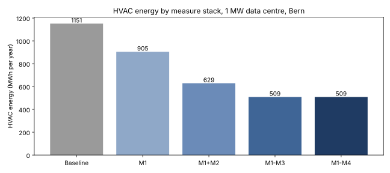
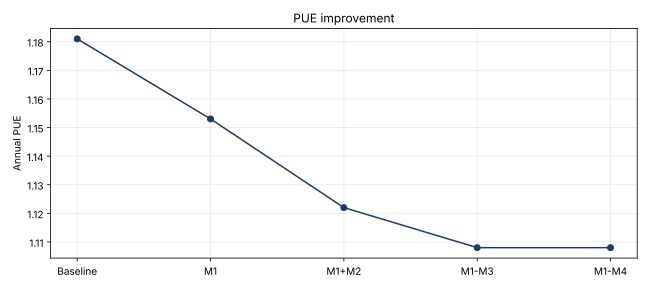

# Smart HVAC Energy Optimisation for a Data Centre in Bern, with Brick Schema

A Brick Schema model of a representative 1 MW data centre in the Bern region, used to
**diagnose HVAC inefficiencies automatically and quantify energy savings** against
ASHRAE TC 9.9, SIA 382/1 and Swiss cantonal energy-law (MuKEn) expectations.

> Technical case study by Amir Razmi. Site, equipment and operating data are
> representative assumptions; replace them with real BMS data to apply the method to a real facility.

## Why Brick

Every BMS names its points differently. A Brick model gives each sensor, setpoint and
piece of equipment a shared meaning and relationships (`hasPoint`, `feeds`, `hasPart`,
`hasLocation`). The diagnostics below find their data **through SPARQL queries on the
graph**, not through hard-coded tag names, so the same rules run on any site that has a Brick model.

## The facility (representative)

| Element | Assumption |
|---|---|
| IT load | 1 MW: Hall A 400 kW air-cooled, Hall B 600 kW direct-to-chip liquid-cooled |
| Air side | 4 CRAH units on the chilled water loop, fans at constant 100 % |
| Liquid side | 2 CDUs, fed from the same 10 °C chilled water loop |
| Plant | 2 chillers, 2 dry coolers for free cooling, 2 pumps |
| Climate | Synthetic hourly year for Bern from monthly mean temperatures |
| Energy price | CHF 0.20 per kWh |

## Automated findings

| Finding | Evidence from the data | Measure |
|---|---|---|
| Overcooling | CRAH supply air 18 °C, the bottom of the ASHRAE recommended range (18–27 °C) | Raise supply air to 24 °C, chilled water to 16 °C |
| Bypass air | Air ΔT only 7.5 K with fans at 100 % (design about 12 K) | Cold-aisle containment, fan speed control |
| Liquid cooling on cold water | CDUs fed by 10 °C chilled water, although direct-to-chip racks accept warm water | Separate warm-water loop at ASHRAE W32 |
| Limited free cooling | Chillers run about 2,800 h per year while outdoor air is below 12 °C | Follows from higher water temperatures |
| No heat reuse | No heat meter or reuse connection in the model | Warm CDU return water to district heating |

## Results: measure stack

| Step | PUE | HVAC energy (MWh/a) | Chillers | CRAH fans | HVAC cost (kCHF/a) | Saving |
|---|---|---|---|---|---|---|
| Baseline | 1.181 | 1,151 | 586 | 385 | 230 | – |
| M1 Raise air to 24 °C, CHW to 16 °C | 1.153 | 905 | 308 | 385 | 181 | 21 % |
| M2 + Containment, fans to ~65 % | 1.122 | 629 | 308 | 109 | 126 | 45 % |
| M3 + Warm-water loop W32 for CDUs | 1.108 | 509 | 164 | 109 | 102 | **56 %** |
| M4 + Heat reuse to district heating | 1.108 | 509 | 164 | 109 | 102 | + 2,400 MWh heat |

**Bottom line of the study:** about **640 MWh and CHF 128,000 per year less HVAC energy**,
PUE from 1.18 to 1.11, and about **2,400 MWh of heat per heating season** available for
a low-temperature district heating network.

The biggest single lever is **fan energy**: containment lets the fans slow to about 65 %, and fan power falls with the cube of speed (0.65³ ≈ 0.27).




## Standards and guidance

| Topic | Reference | Use in this study |
|---|---|---|
| IT inlet air | ASHRAE TC 9.9 (recommended 18–27 °C) | Overcooling check, supply air 24 °C |
| Liquid cooling | ASHRAE TC 9.9 liquid classes (W17 to W45) | Warm-water loop at W32 |
| Data centre KPIs | EN 50600 (PUE) | Annual PUE per step |
| Ventilation and air-conditioning, Switzerland | SIA 382/1 | Fan efficiency and system efficiency context |
| Energy law, Switzerland | Cantonal energy laws based on MuKEn | Waste-heat use expectation |
| Fire protection | VKF/AEAI | Not modelled; required for real projects |

## Repository

| File | Purpose |
|---|---|
| `build_model.py` | Builds the Brick graph (`model/bern_dc.ttl`, 224 triples) |
| `hvac_energy.py` | Hourly HVAC energy model and synthetic Bern climate |
| `run_analysis.py` | SPARQL point discovery, rule checks, measure stack, charts |
| `results/` | Findings, measures, charts |

```bash
pip install -r requirements.txt
python run_analysis.py
```

## Apply it to a real site

1. Build the Brick model of the site (or map BMS points, see [hvac-brick-mapping](https://github.com/amirrazmi/hvac-brick-mapping)).
2. Link each point to its BMS trend with `dc:timeseries`.
3. Replace the synthetic climate with MeteoSwiss hourly data (Bern-Zollikofen).
4. Run the same queries and rules; calibrate the energy model against metered data.

## Limitations

First-order physics, synthetic climate, no part-load curves, no redundancy or cost model.
Results show the order of magnitude and the ranking of measures, not guaranteed savings.

## Author

**Amir Razmi**: HVAC and thermal systems engineer for critical facilities, energy optimisation, CFD and semantic building data.
[LinkedIn](https://www.linkedin.com/in/amir-razmi-phd-63194330) · [GitHub](https://github.com/amirrazmi)

License: MIT
